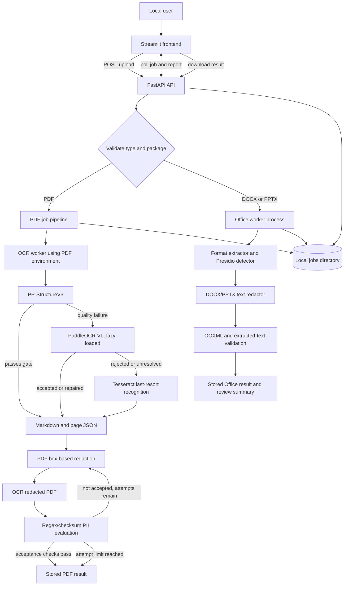

# Local PII Redaction Application

**Technical README and Functional Design Document (FDD)**  
**Application:** Local document processing for PDF, DOCX, and PPTX  
**Execution model:** Local machine; Streamlit frontend; FastAPI backend; format-specific local workers

---

## 1. Purpose and scope

This application accepts a PDF, Word document (`.docx`), or PowerPoint presentation (`.pptx`), identifies supported personally identifiable information (PII), creates a redacted copy, and provides that copy for download in the original file format.

The application is designed for local processing. Uploaded documents, extracted text, intermediate files, reports, and results are written to the local backend job directory. The application does not send document contents to a hosted processing API.

### Supported formats and current processing modes

| Format | Extraction and redaction path | Evaluation shown to the user | Result status |
|---|---|---|---|
| PDF | Native text-layer extraction where reliable; otherwise PP-StructureV3, PaddleOCR-VL, and Tesseract as needed. PII is located against page word boxes and physically redacted. | Regex/checksum-based before-versus-after PII evaluation, redaction verification, and OCR review checks. | `completed` if every configured acceptance check passes; otherwise `completed_review` when a redacted PDF is available. |
| DOCX | OOXML/Word text extraction and Presidio-based PII detection. Text nodes are replaced while retaining unaffected run formatting. | Structural/text validation and a sanitized processing summary; **no numeric PII-reduction score is currently run for DOCX**. | `completed_review`; a human visual/content review is still required. |
| PPTX | Slide text, text-frame content, and table-cell extraction with Presidio-based PII detection. Text is replaced while retaining unaffected runs. | Structural/text validation and a sanitized processing summary; **no numeric PII-reduction score is currently run for PPTX**. | `completed_review`; a human visual/content review is still required. |

The system is a PII redaction tool, not a guarantee that all PII in an arbitrary document has been found. Review the returned document before distribution.

---

## 2. Functional Design Document (FDD)

### 2.1 Actors

| Actor | Responsibility |
|---|---|
| Local user | Selects a supported file, starts processing, follows the job status, reviews the outcome, and downloads the result. |
| Streamlit frontend | Validates file type, uploads the file, submits a job, polls its status, displays evaluation/review information, and exposes the download button. |
| FastAPI backend | Validates and stores uploads, creates and persists job state, dispatches processing to a serialized worker, exposes job/report/result endpoints, and records stage logs. |
| Format worker | Runs the PDF OCR/redaction/evaluation chain or the isolated DOCX/PPTX redactor. |

### 2.2 Functional requirements implemented

1. Accept `.pdf`, `.docx`, and `.pptx` uploads only.
2. Reject malformed files using PDF signature/open checks or Office Open XML ZIP-package markers.
3. Limit uploads to **100 MiB** by default and PDFs to **500 pages** by default. These limits can be changed with backend environment variables.
4. Submit work asynchronously and allow the frontend to poll for status. Processing is serialized: only one document job runs at a time in one backend process; other jobs wait in the executor queue.
5. Keep the original upload and intermediate artifacts in a job-specific directory. Never overwrite the uploaded original.
6. Preserve the input format in the returned result (`.pdf`, `.docx`, or `.pptx`).
7. Return an Office file for review even when the service cannot establish complete visual/media coverage. Do not label an Office result as fully cleared.
8. For PDFs, attempt up to three redact/re-OCR/evaluate rounds and return the last produced redacted PDF for review if no round passes.

### 2.3 Runtime and quality attributes

- **Local execution:** the application processes documents on the host machine and writes job data to its local filesystem.
- **Long-running work:** uploads return a job ID promptly; the frontend polls rather than holding an HTTP upload request open for the full OCR run.
- **Failure containment:** OCR and Office redaction run as child processes. The backend records stage output in job logs and applies a per-command timeout.
- **Serialization:** one backend process runs one document job at a time to limit competing GPU/model memory use.
- **Traceability:** job state, stage logs, PDF page checkpoints, OCR page JSON, evaluation reports, and redaction audit reports are retained with the job.
- **Review safety:** a result that did not satisfy the PDF acceptance gate or has known Office coverage gaps is returned as review-required when a redacted artifact exists.

### 2.4 User-visible job states

| State | Meaning |
|---|---|
| `queued` | The upload passed validation and is waiting for the single processing worker. |
| `processing` | A pipeline stage is running. The job message reports the current stage; PDF OCR may report page progress. |
| `completed` | A PDF met the backend acceptance checks. |
| `completed_review` | A redacted result exists, but one or more checks did not pass or Office visual/media coverage requires human review. |
| `failed` | Processing failed before a usable redacted result was produced. |

If the API process restarts during a queued or active job, the job is marked interrupted when queried. Page-level OCR checkpoints can support the CLI's resume behavior, but the web job queue does not automatically resume an interrupted API job.

---

## 3. System architecture



### 3.1 Process isolation

The API starts document processors as child processes. This keeps model initialization, memory use, and native-library failures out of the HTTP request thread. A one-worker `ThreadPoolExecutor` serializes PDF and Office jobs. Each command writes combined standard output/error to a per-job log, and the backend enforces a configurable command timeout (three hours by default).

The PDF job uses the Python interpreter running the API. The recommended backend command therefore uses `backend/pdf_files/.venv`, which contains the OCR runtime. DOCX/PPTX processing explicitly uses `backend/word_pptx/.venv` so its Python 3.13 dependencies remain separate.

---

## 4. Technology stack

| Layer | Technology | Role |
|---|---|---|
| User interface | Streamlit | Upload, job polling, progress/review display, and file download. |
| HTTP API | FastAPI, Uvicorn | Asynchronous job submission, status/report/result endpoints, local CORS configuration. |
| PDF reading/rendering/redaction | PyMuPDF | Open PDFs, extract text and word geometry, rasterize pages, apply redaction annotations, scrub metadata, and verify output pixels. |
| Primary PDF OCR and layout | PaddleOCR 3.x / PaddlePaddle GPU; PP-StructureV3 | Recognition, layout blocks, tables, and structured page interpretation. |
| PDF OCR fallback | PaddleOCR-VL | Lazy-loaded vision-language fallback for pages or regions that fail PP-StructureV3 quality checks. |
| Final PDF OCR fallback / box locator | Tesseract and `pytesseract` | Last-resort text recognition; also locates word boxes for OCR text so text from the chosen engine can be paired with geometry. |
| Image processing | OpenCV, NumPy, Pillow | Page preprocessing, geometry, figure inspection, and related image operations. |
| PDF PII detector | Local Python rules/checksums, name registry, optional supporting libraries | Structured PII detection, context checks, name propagation, and mapping detected spans to word boxes. |
| PDF evaluation | Local regex/checksum evaluator | Before/after PII reduction score, residual exposure, critical/high leak checks, and text-retention measurement. The web API disables optional ML evaluators. |
| DOCX/PPTX extraction and editing | `python-docx`, `python-pptx`, `lxml` | Read Office content, modify OOXML/PowerPoint text, and validate the saved output. |
| DOCX/PPTX PII detector | Microsoft Presidio Analyzer with spaCy model and custom recognizers | Detect supported person, email, phone, credit-card, and U.S. SSN entities; custom email/phone patterns supplement Presidio. |
| Job persistence | Local filesystem JSON and per-job folders | Persist status, reports, logs, intermediate artifacts, and result files. |

### Runtime environments

The project uses separate environments to avoid mixing GPU OCR and Office dependencies:

| Environment | Python version in the current local setup | Purpose |
|---|---:|---|
| `backend/pdf_files/.venv` | 3.10 | API runtime and PDF OCR/redaction/evaluation child processes. |
| `backend/word_pptx/.venv` | 3.13 | Isolated DOCX/PPTX worker. |
| `frontend/.venv` | 3.10 | Streamlit UI and HTTP client. |

The PDF environment uses `backend/pdf_files/requirements-frozen.txt`; `requirements.txt` delegates to that lock. The Office worker uses `backend/word_pptx/requirements.txt`; the UI uses `frontend/requirements.txt`. PaddlePaddle GPU must remain compatible with the installed CUDA/cuDNN runtime and the pinned wheel.

---

## 5. Repository layout

```text
PII_redaction/
├── README.md                         # This document
├── backend/
│   ├── .venv/                         # Auxiliary backend environment; use the PDF venv for the recommended API launch
│   ├── api.py                         # Upload, job queue, PDF/Office dispatch, status/report/download APIs
│   ├── jobs/                          # Runtime-generated job folders (not source code)
│   ├── pdf_files/
│   │   ├── .venv/                     # PDF/API runtime used by the recommended backend command
│   │   ├── requirements.txt           # Points to requirements-frozen.txt
│   │   ├── requirements-frozen.txt    # PDF/API dependency lock
│   │   ├── processing/
│   │   │   ├── cli.py                 # PDF OCR command, flags, checkpoints, progress, Markdown/JSON output
│   │   │   ├── config.py              # OCR engines, thresholds, language mapping, and configuration validation
│   │   │   ├── pipeline.py            # PDF classification, rendering, quality gates, fallback selection, result assembly
│   │   │   ├── ocr_engine.py          # PP-StructureV3, PaddleOCR-VL, Tesseract, parsing, verification, and merge logic
│   │   │   ├── preprocess.py          # Orientation/deskew, raster variants, polarity and image preparation
│   │   │   ├── textlayer.py           # Reading order and Markdown rendering for native digital text
│   │   │   ├── layout.py              # Image-based table and column geometry helpers
│   │   │   ├── wordbox.py             # Word-level geometry and text-to-box alignment for redaction
│   │   │   ├── models.py              # Page, word, cell, and table data structures
│   │   │   ├── pii_helpers.py         # PDF rule/checksum/name detection helpers and span mapping
│   │   │   ├── redact_pdf.py          # PDF PII redaction, audit output, residual OCR, and verification
│   │   │   ├── presidio_bert_combo.py # Optional BERT/Presidio integration; not enabled by the web API
│   │   │   ├── eval.py                # OCR text-versus-reference evaluation utility; not the web PII evaluator
│   │   │   └── test_wordbox.py         # Word-box geometry/alignment test utility
│   │   └── eval/
│   │       ├── redaction_eval.py      # Before/after PII evaluator used by the PDF web flow
│   │       ├── pii_patterns.py        # Evaluation regexes, checksum validators, entity normalization, risk weights
│   │       ├── md_to_text.py          # Markdown-to-text conversion used for evaluation
│   │       └── pii_config.example.json# Example optional evaluator rules/weights/allowlist
│   └── word_pptx/
│       ├── .venv/                     # Isolated Python 3.13 Office worker environment
│       ├── process_document.py        # Generic Office worker entry point called by FastAPI
│       ├── requirements.txt           # Separate Office-worker dependencies
│       ├── README.md                  # Upstream Office tool notes and known limits
│       ├── tests/                     # Sample/demonstration extract, detector, redactor, and audit utilities
│       ├── config/docx_image_redactions.json # Hash-guarded reviewed DOCX image masks
│       ├── detectors/presidio_detector.py   # Presidio and custom email/phone detector
│       ├── extractors/docx_extractor.py     # DOCX normalized content extraction
│       ├── extractors/pptx_extractor.py     # PPTX slide/table normalized content extraction
│       ├── models/document.py          # Normalized document/block data model
│       └── redaction/
│           ├── docx_redactor.py        # DOCX XML text, metadata, reviewed image handling, validation
│           ├── pptx_redactor.py        # PPTX run/table text replacement, metadata, validation
│           ├── image_redactor.py       # Pixel edits for manifest-approved DOCX media
│           └── DOCX_REDACTION.md       # DOCX-specific review and image policy
└── frontend/
    ├── .venv/                         # Streamlit frontend environment
    ├── app.py                          # Streamlit user interface and job polling
    ├── api_client.py                   # HTTP upload, poll, report, and download client
    ├── validation.py                   # Client-side extension/package validation and MIME selection
    ├── mock_server.py                  # Local mock API for frontend development
    ├── requirements.txt                # Frontend dependencies
    └── tests/                          # Frontend client, validation, and UI tests
```

Generated `__pycache__` and test caches are omitted. The virtual environments are shown for orientation but their contents are not expanded. The `jobs/` folder is created and populated at runtime; it is not an output-only folder.

---

## 6. PDF processing: extraction, selection, and output

### 6.1 Input classification and native text

The PDF pipeline classifies each page as `digital`, `scanned`, `hybrid`, `vector`, or `blank`. It checks the existing text layer, text quality, image coverage, vector-drawing density, and remaining visible ink. Trusted digital text is extracted directly with PyMuPDF and laid out in reading order; it does not need a neural OCR pass. Hybrid pages retain/map usable native text and OCR uncovered content. Blank pages are recorded without running the OCR models.

Pages requiring OCR are rasterized at the configured base DPI (300 by default). The shared preparation path can orient, deskew, correct polarity, and create targeted retry variants. Word and block geometry is converted back to unrotated PDF-point coordinates for later redaction.

### 6.2 OCR engine order

The web API runs the PDF CLI with `--device gpu:0`, `--fallback-engine vl`, `--workers 0`, and `--strict` by default. The device and fallback engine can be overridden with environment variables described below.

1. **PP-StructureV3 is primary.** It returns structured blocks, labels, tables, recognized text, and recognition confidence. Enabled defaults include table recognition and region detection; formula and chart recognition are off by default.
2. **A quality gate checks the primary result.** It uses text-recognition confidence—not layout-detection confidence—plus completeness, uncovered ink, text noise, word spacing, overlap, reading order, and table coherence. The default Paddle recognition threshold is `0.85` (0–1 scale). Small blocks under the configured minimum character count do not fail solely due to a low score.
3. **PaddleOCR-VL is loaded only when required.** It is used for a whole-page structural failure, a page with substantial uncovered ink, or targeted failing blocks. VL has no token confidence score, so its result is checked for empty/degenerate output, plausible length, table quality, noise, and agreement with a trusted reference when one exists. An accepted VL result can replace/rebuild a page or repair a region.
4. **Tesseract is last-resort recognition.** It runs after VL is rejected/unavailable or leaves content unresolved. With usable Paddle structure, Tesseract lines are matched back to blocks; if structure itself failed, it can rebuild a best-effort page. Tesseract’s 0–100 confidence is not compared with Paddle’s 0–1 recognition confidence.
5. **Retry DPIs are disabled by default.** They can be configured for weak pages, but each retry costs another inference pass and may increase GPU memory/time use. The pipeline stops retrying when a candidate is no longer weak and keeps the highest-ranked result.

For a structurally usable page, a pass through the primary quality gate means there is no fallback OCR. Therefore the engine report can truthfully show PP-StructureV3 for the page even when fallback support is enabled.

### 6.3 Markdown and structured page JSON

Markdown is the OCR pipeline’s user-facing extraction artifact. It includes one HTML comment per source page with the selected engine/structure and review flags, followed by the Markdown content. Tables are emitted as Markdown tables when available. This preserves useful structure, but Markdown is not a pixel-perfect copy of the PDF.

The per-page JSON is diagnostic/internal output, not the frontend download. It contains the source page number/type, selected engine, score where available, warnings, attempts and gate reasons, blocks, page statistics, and word boxes. Each word-box entry includes the recognized token and character offsets into `words_text`, pixel/PDF bounding boxes where available, source, status, locator confidence, and block/line grouping.

For OCR-derived blocks, the selected engine supplies the text. Tesseract is used as a **geometry locator**, and character-level alignment maps that text to Tesseract’s word boxes. This allows the preferred engine’s text to retain box coordinates even when Tesseract reads a token differently. Native digital PDFs use the PDF text layer’s word coordinates. Tokens that cannot be aligned are retained with a conservative line/block fallback box and are marked with a weaker status; they are not silently dropped.

When the API runs OCR, files are written under the job folder:

```text
original_ocr/<input-stem>.md
original_ocr/_internal/<input-stem>.pages.json
original_ocr/_internal/checkpoints/<input-stem>/...
```

The redacted-PDF OCR and its Markdown/JSON/checkpoints are stored under the corresponding `attempt_N/redacted_ocr/` directory.

---

## 7. PDF PII identification and physical redaction

### 7.1 PDF PII identification

The API invokes the local PDF redactor without `--bert`, so the web flow uses the deterministic rule/checksum/name-registry path; it does not turn on the optional BERT/Presidio combination in `presidio_bert_combo.py`. Depending on available optional libraries, the helper path also uses phone validation, an offline first-name gazetteer, fuzzy surname comparison, and image utilities.

The rule set includes supported patterns for examples such as person names, email addresses, phone numbers, addresses, dates, IPv4 addresses, account/card fragments, and structured identifiers such as SSN, Aadhaar, PAN, passport, tax IDs, IBAN, PESEL, and employee IDs. Context terms and validators/checksums are used where implemented to reduce false positives. A document-level name registry can use one occurrence to find related name/surname occurrences elsewhere in the document. The redactor applies the built-in allowlist for known non-person terms/addresses.

Detected text spans are mapped to the PDF page’s `words_text` offsets. Those offsets intersect the word JSON to select boxes. Sub-word spans use a proportional horizontal estimate when the box is reliable. Coarse line/block boxes are re-located with local OCR when possible; locations that remain too coarse can be left unresolved and reported for review rather than applying an excessively large mask.

### 7.2 PDF redaction behavior

For each detection, the redactor creates and merges PDF-space rectangles, adds a small padding, and applies actual PyMuPDF redactions. It handles image pixels as well as text under the target rectangle, scrubs metadata/embedded attachments, and writes an audit JSON beside each attempt PDF.

The API uses:

```text
--figures hybrid --dates all
```

In `hybrid` figure mode, evidence-like figure regions identified by nearby captions (for example, screenshots, credentials, scans, or audit evidence) are blanked as a whole. Other detected image/chart regions are inspected with local OCR and available OpenCV face/QR/barcode routines. `--dates all` makes date spans eligible for detection, not just dates explicitly labeled as a date of birth.

The redactor then runs a residual OCR loop over the output, applies additional masks for readable remaining PII (up to two corrective rounds), and verifies the output. Verification checks for a remaining text layer and samples pixels in each redaction rectangle to confirm they are dark. A failed verification returns a nonzero exit code and prevents that attempt from satisfying the API pass gate.

**Consequence:** the redacted PDF is intended to be a flattened/redacted distribution artifact; its original searchable text layer is not retained. Keep the original separately if it must remain available under controlled access.

---

## 8. PDF evaluation and acceptance score

### 8.1 What the score measures

The PDF score measures estimated **PII exposure reduction** between the original OCR Markdown and a redacted attempt’s OCR Markdown. It is not OCR character accuracy, not a guarantee of zero PII, and not the PaddleOCR recognition-confidence score.

The web API calls the evaluator with `--models none --no-cache`. Regex/checksum detection is therefore always enabled, while optional model detectors (such as the evaluator’s GLiNER or Hugging Face integrations) are disabled in the web flow. Both the original and redacted text are analyzed using the same enabled rules.

### 8.2 Entity weights and grouping

Each detected occurrence gets a risk weight based on its entity type, confidence/validation, and nearby PII linkage. The risk table assigns greater weight to critical data (for example, SSN, payment-card, password, Aadhaar), then high-risk identifiers (for example, passport, tax, bank, and some financial identifiers), with lower weights for medium/low categories. Entity tiers derive from the base weights: critical `>= 8`, high `>= 5`, medium `>= 3`, otherwise low.

Repeated occurrences of the same normalized value and type are grouped. The group weight uses the mean occurrence weight multiplied by a repetition factor:

```text
group_weight = mean_occurrence_weight × (1 + 0.25 × log2(occurrence_count))
```

Nearby person/identifier values can increase linkage weight (up to a 1.3 multiplier). Checksum-validated findings receive a minimum confidence floor in the weight calculation.

### 8.3 Leak matching and score

The evaluator searches the redacted text for normalized forms of original values. Exact matches count as full leaks. Some text entities can receive partial-token leakage credit; supported long identifier types can receive partial-run credit if enough contiguous characters survive. PII detected only in the redacted file is counted as new exposure with a default factor of `0.5` in the API invocation.

```text
residual_weight = Σ(original_group_weight × leak_fraction)
                  + 0.5 × Σ(weight of newly detected after-only groups)

raw_score = max(0, 100 × (1 - residual_weight / original_total_weight))
```

If no PII is detected in the original, the score is unavailable (`null`/N/A) rather than a fabricated 100.

The raw score is capped when critical or high-risk values remain exposed. A critical leak caps the score at 79, reducing the cap by 5 for each additional critical leak down to 40. A high-risk leak caps it at 94, reducing the cap by 2 for each additional high leak down to 80. The final evaluator score is the lower of the raw score and applicable cap.

Other reported metrics include weighted PII reduction, unique-value reduction, unique values still leaking, new exposure, critical/high leak counts, per-type breakdown, and non-PII text retention. A low text-retention result is a warning for possible over-redaction or mismatched input files; it is not by itself the score formula.

### 8.4 Evaluator verdict versus web API pass gate

These are separate rules and must not be conflated:

| Check | Rule |
|---|---|
| Evaluator’s printed `PASS` | Score `>= 95` and zero critical/high leaks. |
| Evaluator’s printed `REVIEW` | Score `>= 80` but it does not meet the `PASS` rule. |
| Evaluator’s printed `FAIL` | Score `< 80`. |
| Web API PDF acceptance | Score **strictly greater than 85**, zero critical/high leaks, redactor exit code 0, original and redacted OCR exit codes 0, and zero original/redacted pages flagged for OCR review. |

As a result, the API acceptance gate may pass a score from just above 85 up to below 95 if all additional checks pass, even though the evaluator’s own verdict is `REVIEW`. Conversely, a high score is not enough if critical/high leaks, a redaction verification error, a needs-review page, or a nonzero/strict-review OCR exit code remains.

### 8.5 Three-attempt PDF loop

The original OCR Markdown stays fixed as the comparison baseline. For each attempt:

1. Redact the current PDF using the word-box JSON produced from that exact PDF.
2. OCR the redacted PDF and write a new Markdown/word-box JSON pair.
3. Evaluate the original Markdown against that attempt’s redacted Markdown.
4. Stop if the API acceptance gate passes. Otherwise, use the latest redacted PDF and its matching page JSON as the next attempt’s input, up to three total attempts.

If all three attempts finish without passing, the last redacted PDF is retained and the job is `completed_review`. If a later stage errors after a redacted PDF exists, the latest redacted artifact is preserved as `completed_review` with an error message. If no redacted artifact was produced, the job is `failed`.

---

## 9. DOCX and PPTX processing

### 9.1 DOCX

The DOCX worker uses `python-docx` to build a normalized body/table view, then the XML redactor traverses supported Word XML parts, including ordinary paragraphs and tables and relevant headers, footers, notes, and comments. PII matches are replaced with the fixed placeholder `xxxxxxxxxx`; unaffected run properties are retained where possible. The redactor also handles selected metadata, field cases, external targets, and reviewed image regions.

Image redaction is deliberately restricted. `config/docx_image_redactions.json` contains image hashes and approved rectangles. A mask is applied only when the uploaded media part matches a reviewed hash. Unknown or changed images are left untouched and reported as unreviewed. The manifest is specific to known reviewed media; it is not a general image PII detector.

The redactor checks its expected text replacements and re-extracts the saved document to ensure the extracted structure is stable. This is a structural/text check, not a full visual proof. DOCX is always returned as `completed_review`.

### 9.2 PPTX

The PPTX extractor processes slide text shapes and table cells. The redactor maps detected text spans back to the original text runs, replaces them with `xxxxxxxxxx`, checks that extracted output text matches the expected redaction, and removes author/last-modified metadata where present.

The documented PPTX extractor does not OCR text inside images or cover every unsupported PowerPoint object/content part. The backend therefore returns a review-required summary and `completed_review`, even when its extracted text validation passes.

### 9.3 Office PII detector and limitations

The Office worker creates a Presidio `AnalyzerEngine` with supported entities `PERSON`, `EMAIL_ADDRESS`, `PHONE_NUMBER`, `CREDIT_CARD`, and `US_SSN`. It also adds custom email and phone recognizers, resolves overlapping spans, and learns selected names from labeled table content before redaction. The Office flow does not run the PDF evaluator or the PDF three-attempt loop. It currently has no numeric before/after PII-reduction score.

Office validation means the generated package can be reopened and its supported extracted text matches the planned redactions. It does **not** prove that every PII value was detected, nor does it establish that images, unsupported objects, visual layout, and all user-visible content are clean. Visually inspect the result and review the reported coverage limitations.

---

## 10. API and frontend contract

| Endpoint | Method | Purpose |
|---|---|---|
| `/health` | GET | Simple backend health response. |
| `/api/v1/jobs` | POST | Multipart upload and asynchronous job creation. Returns a job ID and initial state (`202 Accepted`). Optional `Idempotency-Key` avoids duplicate jobs on a safe retry. |
| `/api/v1/jobs/{job_id}` | GET | Poll status, stage, progress, summary/evaluation, and result availability. |
| `/api/v1/jobs/{job_id}/report` | GET | Retrieve the sanitized evaluation or processing summary when available. |
| `/api/v1/jobs/{job_id}/result` | GET | Download the completed or review-required result with its matching format and MIME type. |

The Streamlit frontend uses the API URL `http://127.0.0.1:8000` by default. The UI polls every two seconds while a job is active, then fetches the report and result and retains them in the session for the download button. Transient status-poll errors do not cause the frontend to submit a duplicate job.

---

## 11. Runtime storage and file retention

The default job root is `backend/jobs/`. Each upload gets a 32-character hexadecimal job ID and its own directory. The backend also writes `job.json` as an atomic status snapshot.

### PDF job example

```text
backend/jobs/<job-id>/
├── input.pdf                         # original uploaded PDF
├── job.json                          # current/persisted job state and summary
├── original_ocr/
│   ├── input.md                      # OCR text of the original (may contain raw PII)
│   └── _internal/
│       ├── input.pages.json           # page/block/word-box diagnostics
│       └── checkpoints/input/         # page checkpoints and manifest
├── original_ocr.log
├── attempt_1_redact.log
├── attempt_1_after_ocr.log
├── attempt_1_evaluation.log
├── attempt_1/
│   ├── redacted_attempt_1.pdf
│   ├── redacted_attempt_1.pdf.audit.json
│   ├── redacted_ocr/                  # OCR Markdown, JSON, and checkpoints for that attempt
│   └── evaluation/                    # redacted-vs-original evaluation JSON
├── attempt_2/ ...                     # present when another attempt runs
└── result.pdf                         # final file offered for download
```

### DOCX/PPTX job example

```text
backend/jobs/<job-id>/
├── input.docx or input.pptx
├── job.json
├── office_redaction.log
├── processing_summary.json            # sanitized counts/coverage summary
├── result.docx or result.pptx          # file offered for download
└── result.review.json                  # DOCX only; detailed report may contain original PII
```

The job directory is the local processing record, not a temporary upload directory. There is **no automatic job cleanup or retention expiry** in the current API. Original PDFs, extracted original Markdown, Office inputs, DOCX review reports, and intermediate results can contain sensitive information. Restrict access to `backend/jobs/`, back it up only under approved controls, and delete completed job folders when retention is no longer required. Do not expose this directory through a static web server.

---

## 12. Run the application locally (Windows PowerShell)

Use two PowerShell windows. These commands use the project environments already configured in the current workspace; explicit interpreter paths avoid needing to activate environments.

### Terminal 1 — backend API

```powershell
Set-Location D:\ocrr\PII_redaction\backend
& .\pdf_files\.venv\Scripts\python.exe -m uvicorn api:app --host 127.0.0.1 --port 8000
```

Check that it is listening from another terminal:

```powershell
Invoke-RestMethod http://127.0.0.1:8000/health
```

### Terminal 2 — Streamlit frontend

```powershell
Set-Location D:\ocrr\PII_redaction\frontend
& .\.venv\Scripts\python.exe -m streamlit run app.py
```

Open the local URL Streamlit prints (normally `http://localhost:8501`), choose a PDF/DOCX/PPTX file, and click **Process document**. Keep both terminal windows running until processing and download are complete. For a PDF, the PDF OCR environment defaults to GPU device `gpu:0` and PaddleOCR-VL fallback. The first OCR run may take longer while local OCR models initialize; availability of a compatible Paddle GPU runtime is required for GPU inference and PaddleOCR-VL. Tesseract must also be installed and discoverable by the PDF environment for final OCR fallback and word-box location.

### Environment variables

| Variable | Default | Effect |
|---|---|---|
| `API_BASE_URL` | `http://127.0.0.1:8000` | Backend URL used by the frontend. |
| `PII_JOBS_DIR` | `backend/jobs` | Absolute or relative path used for persistent job folders. |
| `PII_MAX_UPLOAD_BYTES` | `104857600` | Maximum upload size in bytes. |
| `PII_MAX_PDF_PAGES` | `500` | Maximum pages accepted in one PDF. |
| `PII_OCR_DEVICE` | `gpu:0` | Paddle device passed to the PDF pipeline, e.g. `gpu:0` or `cpu`. |
| `PII_OCR_FALLBACK_ENGINE` | `vl` | PDF fallback policy (`vl` or `tesseract`, subject to the CLI choices). With `vl`, Tesseract remains the last-resort tier. |
| `PII_COMMAND_TIMEOUT_SECONDS` | `10800` | Timeout per child-process command (three hours). |
| `PII_FRONTEND_ORIGINS` | `http://127.0.0.1:8501,http://localhost:8501` | Comma-separated CORS origins allowed by the API. |

To change an environment variable in PowerShell, set it in the backend terminal before starting Uvicorn, for example:

```powershell
$env:PII_OCR_DEVICE = "cpu"
```

The Office worker uses its own `.venv` and does not inherit the backend Python package environment.

---

## 13. Operational constraints and review guidance

- **Local development service:** the API has no user authentication or authorization. Keep it bound to `127.0.0.1`; do not expose it to a public or shared network without adding appropriate access controls, transport security, and deployment hardening.
- **Single-process job queue:** jobs are serialized by one in-process executor. This is appropriate for local use, not a multi-user distributed production queue. The current queue is not durable across API restarts.
- **GPU and memory:** PP-StructureV3 uses multiple models; PaddleOCR-VL is GPU-only in this configuration and lazy-loaded. Concurrent jobs/workers can multiply memory use. The web worker intentionally runs one job at a time.
- **Model assets:** inference runs locally. A model that is not already available in the local Paddle cache may need to be downloaded during initialization; prepare the environment/cache before offline use.
- **PDF score scope:** the PII score estimates remaining detected PII; it does not measure OCR character error rate. OCR quality is separately gated and reported per page.
- **Office coverage:** supported extracted text is redacted and validated, but image text and unsupported parts are not fully covered. DOCX image masks apply only to matching reviewed image hashes. Manual visual review is required.
- **False positives and false negatives:** heuristic, checksum, Presidio, and OCR systems can miss or over-detect values. A successful validation is evidence that configured checks passed, not proof that every possible identifier was handled.
- **Logs and artifacts:** job logs and intermediate outputs are persisted and may reveal filenames, paths, or processing metadata. The original OCR text and DOCX review report can contain direct PII.
- **No Office score:** DOCX/PPTX outputs currently receive structural/text checks and a review summary, not the PDF numeric evaluator.

---

## 14. Screenshot placeholders

Add screenshots here when available. Store images in a project documentation folder such as `docs/screenshots/`, then replace the placeholder notes with the corresponding Markdown image links.

### 14.1 Upload screen

> Screenshot placeholder — Streamlit upload screen with a supported document selected.

### 14.2 Processing status

> Screenshot placeholder — queued/processing state with stage or page progress visible.

### 14.3 PDF evaluation result

> Screenshot placeholder — completed PDF evaluation with score, leak counts, warnings, and download control.

### 14.4 Office review result

> Screenshot placeholder — DOCX/PPTX review summary and format-preserving download control.

### 14.5 Downloaded redacted document

> Screenshot placeholder — example redacted output opened for visual review.
